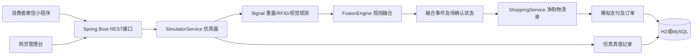
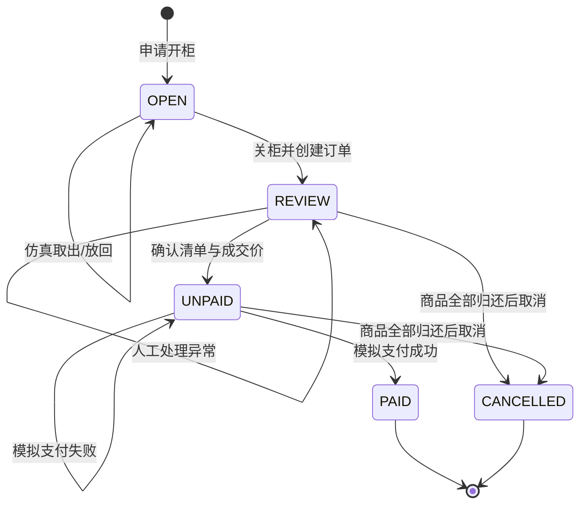

# 系统设计与融合规则

## 一、结构

仿真器知道实际操作，但融合器不知道。`FusionEngine.analyze(Signal,List<Product>)`没有数据库依赖，是可单独测试的纯函数。商品资料只提供SKU、标称重量等先验，不能直接告诉引擎本次操作了什么。

## 二、三步规则

取出为负，放回为正；对每次操作分析一次窗口。

**第一步：重量。** 对每种商品数量n=1…10计算理论重量`W=weightGrams*n`。当`abs(abs(delta)-W) <= max(20,W*0.03)`时加入候选。观测重量绝对值小于5克时不自动确认。20克/3%是教学参数，应在论文实验中解释取值并做误差分析。

**第二步：RFID。** 模拟标签集合差输出`{SKU:带符号数量}`。将其与重量候选的SKU、数量和方向匹配，缩小候选范围。若漏读，RFID输出空集合，不假装它提供了肯定证据。若重量与RFID冲突，不让RFID直接覆盖重量。

**第三步：视觉。** 只输入一个布尔值`visionDifferent`。为true表示有差异，必须人工确认；为false表示没有发现差异，不表示真实视觉识别正确率为100%。

自动确认条件：重量存在候选、RFID不存在冲突、交叉检查后候选唯一、视觉无差异。其他情况都标记PENDING。RFID漏读时，重量唯一且视觉无差异仍可自动确认，并保留RFID缺失提示。

| 情境 | 例子 | 结果 |
|---|---|---|
| 重量、RFID一致 | −330克、COLA:−1、视觉无差异 | 可乐1件，自动确认 |
| 等重+漏读 | −330克、RFID为空 | 可乐/橙汁不能区分，待确认 |
| RFID冲突 | −550克、COLA:−1 | 重量指向水，待确认 |
| 视觉差异 | −330克、COLA:−1、有差异 | 待确认 |
| 大重量误差 | −400克、不匹配 | 待确认 |
| 放回 | +660克、COLA:+2 | 放回可乐2件 |

不使用随机误差；仿真面板明确填写误差，便于每次复现同一案例。可在不同操作中手动改变参数，形成实验数据。

## 三、状态

柜门关闭不等于柜体立刻可用：有未完成订单时仍保持占用，避免不同消费者混用一个购物会话。管理员可执行“全部归还并取消”回收未支付会话，包括后端重启后遗留的演示身份会话。

## 四、事务和幂等

`@Transactional`将物理库存变化、操作记录、感知事件和库存流水纳入同一个事务。任一写入失败时整体回滚。

开柜先`SELECT ... FOR UPDATE`锁定柜体；支付锁定会话及订单。对同一柜体的并发开柜仅有一个成功。支付使用唯一`request_key`，同一请求重发不会再次记账。已PAID订单收到新的支付请求也不会重复增加销量。

金额用整数“分”；确认清单时把商品名称、数量、单价和小计存成快照。之后商品改价不影响历史订单。失败支付尝试单独保存，统计时只计算成功订单。

## 五、库存核对

物理库存与订单识别结果有不同来源：前者来自仿真操作，后者来自融合及人工确认。人工确认错商品时，系统不篡改原始融合结果或偷偷纠正账单，而是在管理台显示`discrepancy`。这能解释识别错误对库存账务的影响。

本项目提供差异提示而非自动盘盈盘亏调整。演示时应正确核实异常商品。若发生人为错认，管理员可借助仿真记录、感知证据和订单快照追查原因；正式系统还需要盘点审批与退款流程。
